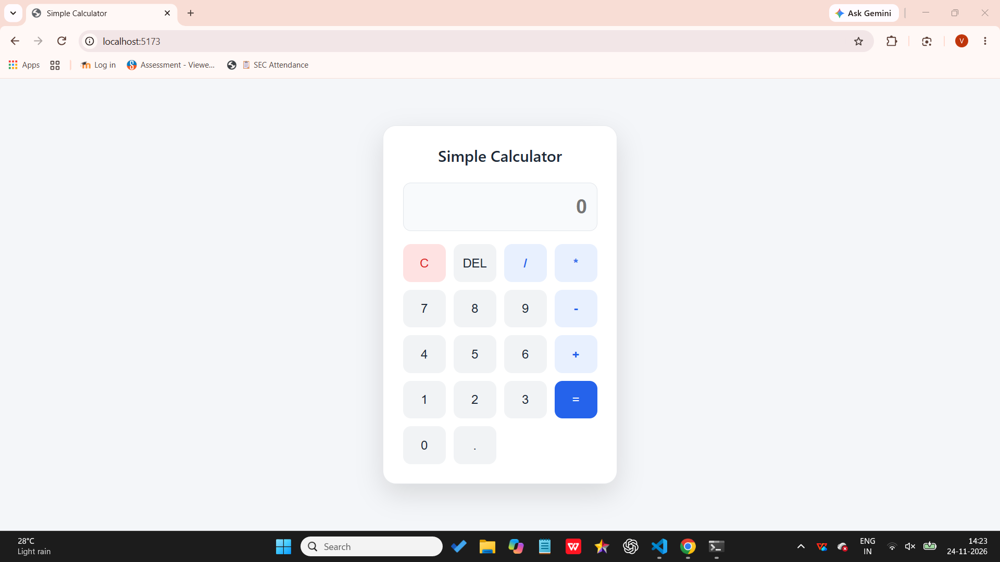

# Exp-4_React-Calci
## Date: 24.11.2026
## Name : Vanathi T
## Reg No : 212225040480

## AIM
To  develop a Simple Calculator using React.js with clean and responsive design, ensuring a smooth user experience across different screen sizes.

## ALGORITHM
### STEP 1
Create a React App.

### STEP 2
Open a terminal and run:
  <ul><li>npx create-react-app simple-calculator</li>
  <li>cd simple-calculator</li>
  <li>npm start</li></ul>

### STEP 3
Inside the src/ folder, create a new file Calculator.js and define the basic structure.

### STEP 4
Plan the UI: Display screen, number buttons (0-9), operators (+, -, *, /), clear (C), and equal (=).

### STEP 5
Create a new file Calculator.css in src/ and add the styling.

### STEP 6
Open src/App.js and modify it.

### STEP 7
Start the development server.
  npm start

### STEP 8
Open http://localhost:3000/ in the browser.

### STEP 9
Test the calculator by entering numbers and operations.

### STEP 10
Fix styling issues and refine content placement.

### STEP 11
Deploy the website.

### STEP 12
Upload to GitHub Pages for free hosting.

## PROGRAM

# App.jsx
```
import { useState } from "react";
import "./App.css";

function App() {
  const [display, setDisplay] = useState("");

  const handleClick = (value) => {
    if (value === "C") {
      setDisplay("");
    } 
    else if (value === "DEL") {
      setDisplay(display.slice(0, -1));
    } 
    else if (value === "=") {
      try {
        setDisplay(eval(display).toString());
      } catch {
        setDisplay("Error");
      }
    } 
    else {
      setDisplay(display + value);
    }
  };

  const buttons = [
    "C", "DEL", "/", "*",
    "7", "8", "9", "-",
    "4", "5", "6", "+",
    "1", "2", "3", "=",
    "0", "."
  ];

  return (
    <div className="calculator-container">
      <div className="calculator">
        <h2>Simple Calculator</h2>

        <input
          type="text"
          value={display}
          readOnly
          placeholder="0"
        />

        <div className="buttons">
          {buttons.map((button) => (
            <button
              key={button}
              onClick={() => handleClick(button)}
              className={
                button === "="
                  ? "equal"
                  : button === "C"
                  ? "clear"
                  : ""
              }
            >
              {button}
            </button>
          ))}
        </div>
      </div>
    </div>
  );
}

export default App;

```
# App.css

```
* {
  margin: 0;
  padding: 0;
  box-sizing: border-box;
}

body {
  font-family: "Inter", "Segoe UI", Arial, sans-serif;
  background: #f4f6f9;
  min-height: 100vh;
}

/* Main Container */
.calculator-container {
  min-height: 100vh;
  display: flex;
  justify-content: center;
  align-items: center;
  padding: 20px;
}

/* Calculator */
.calculator {
  width: 360px;
  padding: 30px;
  background: #ffffff;
  border-radius: 20px;
  box-shadow: 0 15px 40px rgba(0, 0, 0, 0.12);
  border: 1px solid #e8eaed;
}

/* Heading */
h2 {
  text-align: center;
  color: #1f2937;
  font-size: 24px;
  font-weight: 600;
  margin-bottom: 25px;
}

/* Display */
input {
  width: 100%;
  height: 75px;
  border: 1px solid #e1e5ea;
  outline: none;
  border-radius: 12px;
  background: #f8fafc;
  color: #111827;
  padding: 15px;
  margin-bottom: 20px;

  font-size: 30px;
  font-weight: 600;
  text-align: right;
}

input:focus {
  border-color: #2563eb;
}

/* Buttons */
.buttons {
  display: grid;
  grid-template-columns: repeat(4, 1fr);
  gap: 12px;
}

button {
  height: 58px;
  border: none;
  border-radius: 12px;

  background: #f1f3f5;
  color: #1f2937;

  font-size: 19px;
  font-weight: 500;

  cursor: pointer;
  transition: all 0.2s ease;
}

button:hover {
  background: #e2e6ea;
}

button:active {
  transform: scale(0.96);
}

/* Clear Button */
.clear {
  background: #fee2e2;
  color: #dc2626;
}

.clear:hover {
  background: #fecaca;
}

/* Equal Button */
.equal {
  background: #2563eb;
  color: white;
  grid-row: span 2;
}

.equal:hover {
  background: #1d4ed8;
}

/* Operators */
button:nth-child(3),
button:nth-child(4),
button:nth-child(8),
button:nth-child(12) {
  background: #e8f0fe;
  color: #2563eb;
  font-weight: 600;
}

button:nth-child(3):hover,
button:nth-child(4):hover,
button:nth-child(8):hover,
button:nth-child(12):hover {
  background: #dbe7fd;
}

/* Responsive */
@media (max-width: 400px) {
  .calculator {
    width: 100%;
    padding: 22px;
  }

  input {
    height: 65px;
    font-size: 26px;
  }

  button {
    height: 54px;
  }
}

```

## OUTPUT



## RESULT
The program for developing a simple calculator in React.js is executed successfully.
